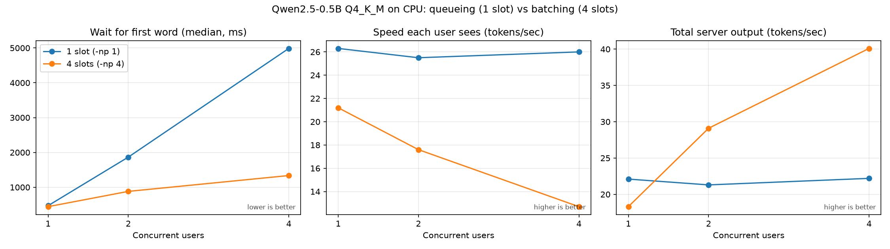
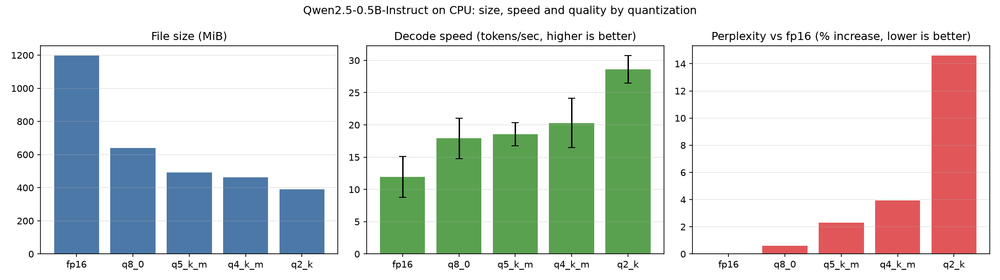

# llm-inference-lab

Serving and measuring a small LLM (Qwen2.5-0.5B-Instruct) on a laptop CPU with llama.cpp. Two experiments: how server concurrency settings trade latency against throughput, and how quantization trades size, speed, and quality. Results come with honest error bars.

## Key findings

1. **Batching trades per-user speed for throughput.** With 4 concurrent users, 4 server slots cut the median wait for the first token from 5.0 s to 1.3 s and raised total throughput 1.8x (22.2 to 40.1 tok/s), while each user's own speed fell from 26.0 to 12.7 tok/s.
2. **Decode speed follows file size.** Sorted by size, the five quantizations come out in the same order of decode speed. Size times speed is about 9-14 GiB/s for all of them, consistent with decoding being limited by memory bandwidth.
3. **Q8_0 is nearly free, Q2_K is not.** Perplexity rises only 0.6% for Q8_0 (about half the size of fp16) but 14.6% for Q2_K.
4. **Only the extremes are clear on this laptop.** fp16 was the slowest and Q2_K the fastest in all three rounds. Q8_0, Q5_K_M, and Q4_K_M are statistically tied.

## Setup

- Model: Qwen2.5-0.5B-Instruct, official GGUF files (fp16, Q8_0, Q5_K_M, Q4_K_M, Q2_K)
- Engine: llama.cpp built from source, CPU only (`llama-server`, `llama-bench`, `llama-perplexity`)
- Software: Ubuntu in WSL2 on a Windows laptop, Python 3.14
- CPU: 11th Gen Intel(R) Core(TM) i5-1135G7 @ 2.40GHz (8 threads, 4 used for inference)
- Memory: 7.7 GB RAM on the laptop, about 3.7 GiB visible inside WSL

## Experiment 1: concurrency (slots)

`llama-server -t 4 -c 2048` with `-np 1` (one slot, requests queue) versus `-np 4` (four slots, requests batched). An async Python client sends 1, 2, or 4 simultaneous streaming requests (64 tokens, temperature 0, prompt cache off), 3 rounds per level. TTFT is the time from sending the request to the first streamed token.

| Slots | Users | TTFT median | TTFT worst | Per-user tok/s | Total tok/s |
|---:|---:|---:|---:|---:|---:|
| 1 | 1 | 471 ms | 497 ms | 26.3 | 22.1 |
| 1 | 2 | 1866 ms | 3975 ms | 25.5 | 21.3 |
| 1 | 4 | 4987 ms | 9541 ms | 26.0 | 22.2 |
| 4 | 1 | 443 ms | 472 ms | 21.2 | 18.3 |
| 4 | 2 | 882 ms | 917 ms | 17.6 | 29.1 |
| 4 | 4 | 1337 ms | 1734 ms | 12.7 | 40.1 |



With one slot, each request runs at full speed but the others wait, so TTFT grows with the queue while total throughput stays flat. With four slots, requests are decoded together: waiting time stays low and total output rises, but the CPU is shared, so each user gets slower. The gain is 1.8x, not 4x, because slots do not add cores. Note that `-c` is split across slots, so with four slots each one has only 512 tokens of context.

## Experiment 2: quantization

Speed: `llama-bench` with a 128-token prompt (prefill) and 64 generated tokens (decode), 4 threads. Three rounds with the models in a shuffled order each time, 5 repeats per measurement, and a 15 s cooldown between models. The table shows the median of the round averages, and the ± is the spread between rounds.

Quality: perplexity on the first 20 chunks of 512 tokens of the WikiText-2 test set, identical text for every model. Lower is better, and the last column is the increase over fp16.

| Model | Size (MiB) | Decode tok/s | Prefill tok/s | Perplexity | vs fp16 |
|---|---:|---:|---:|---:|---:|
| fp16 | 1198 | 11.9 ± 3.1 | 79 ± 19 | 16.73 | +0.0% |
| q8_0 | 639 | 17.9 ± 3.1 | 87 ± 27 | 16.83 | +0.6% |
| q5_k_m | 492 | 18.6 ± 1.8 | 43 ± 7 | 17.12 | +2.3% |
| q4_k_m | 463 | 20.3 ± 3.9 | 94 ± 4 | 17.39 | +3.9% |
| q2_k | 390 | 28.6 ± 2.1 | 137 ± 6 | 19.17 | +14.6% |



- **Q8_0** is the safe choice: about half the size of fp16, near-identical perplexity (+0.6%), and clearly faster than fp16.
- **Q4_K_M and Q5_K_M** save another 25-30% of memory versus Q8_0 for a 2-4% perplexity increase. On this CPU their speed is statistically tied with Q8_0.
- **Q2_K** is the fastest but loses about 15% in perplexity, which is a visible quality drop.
- **Prefill** is compute-bound rather than bandwidth-bound: Q5_K_M was the slowest quantized format in both of my runs.

My first, unshuffled speed run suggested Q8_0 was faster than Q4_K_M and Q5_K_M. The shuffled rerun did not reproduce that, so I dropped the claim. The first run is kept in `results/quant_speed_first_run.md`.

## Limitations

- One laptop, and noisy: decode speed swung 20-30% between rounds, so only large differences are trustworthy.
- Few samples: 3 rounds per measurement. The "worst TTFT" figures rest on 3-12 requests.
- With 4 slots a single user was slightly slower than with 1 slot (21.2 vs 26.3 tok/s). I could not tell whether that is real overhead or noise.
- Perplexity on 20 chunks (about 10k tokens) has an absolute uncertainty of about 0.7. Perplexity is also a proxy and not task accuracy.
- The client counts streamed chunks as tokens, which is an approximation.
- A 0.5B model on a CPU. Small models are more sensitive to quantization, and on GPUs the speed picture is different.

## Reproduce

```bash
# 1. Build llama.cpp (CPU)
git clone --depth 1 https://github.com/ggml-org/llama.cpp.git ../llama.cpp
(cd ../llama.cpp && cmake -B build && cmake --build build --config Release -j 4 \
  --target llama-server llama-cli llama-bench llama-quantize llama-perplexity)

# 2. Python environment and models
python3 -m venv .venv && source .venv/bin/activate
pip install -r requirements.txt
./scripts/download_models.sh
mkdir -p data && (cd data && sh ../../llama.cpp/scripts/get-wikitext-2.sh)

# 3. Concurrency experiment (restart the server with -np 1, then -np 4)
../llama.cpp/build/bin/llama-server -m models/qwen2.5-0.5b-instruct-q4_k_m.gguf \
  -t 4 -c 2048 -np 1 --host 127.0.0.1 --port 8090
python benchmarks/concurrency.py np1     # then repeat with -np 4 and label np4
python benchmarks/plot_concurrency.py

# 4. Quantization experiment (stop the server first)
python benchmarks/quant_speed_rounds.py
./scripts/run_ppl.sh
python benchmarks/plot_quant.py
```

## Repo layout

```
benchmarks/   client and plotting scripts
scripts/      model download, perplexity and speed runners
results/      raw results (JSON, CSV, logs, markdown tables)
docs/         charts used in this README
models/       GGUF files (not in git)
data/         WikiText-2 (not in git)
```

## Roadmap

- FastAPI gateway with Prometheus metrics, Docker image, and CI
- GPU comparison with vLLM on a rented or free cloud GPU
- Deploy the service through a GitOps repo on Kubernetes
